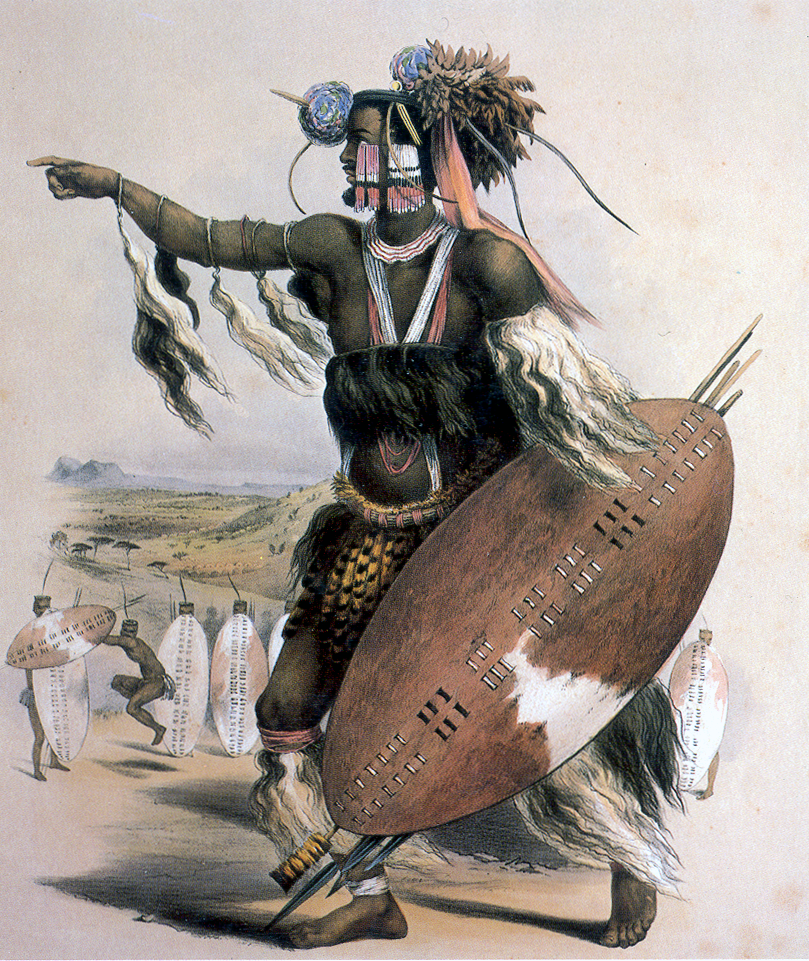

December in the hills of KwaZulu-Natal. The new crops are ripening, but custom holds them back. At the royal homestead young men gather inside the cattle kraal. They carry no spears. A bull is driven in, and they kill it with their bare hands. The Zulu believe its power now passes to the king.[^bull] Then the king eats the first of the new produce, and the harvest is open.[^gluckman]

The Zulu call this festival *Umkhosi Wokweshwama*, the first-fruits festival. In 2009 an animal-rights group went to court to stop it, and lost. The late King Goodwill Zwelithini was furious that anyone had tried to ban it.[^court] And anyone who has read Leviticus will stop and look twice.

## Who the Zulu are

The Zulu are South Africa's largest ethnic group, and isiZulu is the country's most widely spoken home language.[^collector] Their heartland is KwaZulu-Natal, on the Indian Ocean coast. In the early 1800s Shaka built them into a kingdom whose name became famous across the world. The British broke that kingdom in the Anglo-Zulu War of 1879, but the royal house survived, and the king still leads the old festivals.

*Utimuni, nephew of King Shaka, in full regimental dress. Painting by George French Angas. Public domain, via [Wikimedia Commons](https://commons.wikimedia.org/wiki/File:Utimuni.png).*

The Zulu tongue carries the memory of older neighbours. Its click sounds were borrowed from the Khoisan languages of the first peoples of the south.[^clicks] The Bantu languages, isiZulu among them, began around the present border of Cameroon and Nigeria some five thousand years ago, and geneticists find Khoisan ancestry mixed into the Bantu-speaking peoples of southern Africa.[^genes] In short, they are a people from the north.

## Their own story, and the stories told about them

Zulu origin talk has never been one story. It has always been an argument.

In 1825 a young English Jew named Nathaniel Isaacs was shipwrecked near Durban and came to know Shaka's court. In a letter he wrote that Shaka's face showed "a Hebrew expression," and he suspected the Zulu had a Jewish origin. The historian Adam Rovner calls this wishful thinking, an echo of a wider belief of the time, and notes that Isaacs kept such speculation out of his published memoir.[^rovner]

The more striking voices are Zulu. The Natal official James Stuart spent years writing down what Zulu informants told him, and some of them speculated that the Zulu were descendants of the Jews, or one of the ten lost tribes. The Wits historian Hlonipha Mokoena studied these records in a 2018 paper, "'The Black House', or How the Zulus Became Jews." She found that literate Zulu of the 1800s, reading the Bible in their own language, used Israel's scattering as a template for their own migration stories. They called it *indlu emnyama*: "the black house."[^mokoena]

Not every Zulu writer went that way. Magema Fuze, raised in Bishop Colenso's mission and trained as a printer, published *Abantu Abamnyama* ("The Black People and Whence They Came") in 1922, the first book written in isiZulu by a native speaker. Fuze looked to Egypt and Nubia, not Israel, as the cradle of black Africans.[^fuze]

So the Zulu story itself holds both the claim of an Israelite origin, and the doubt. That is a good place to start.

## The Institute's reading

What follows is the Institute's reading. These are likenesses, not proofs. We set them out because Zulu thinkers of the 1800s saw them first, and their instinct deserves a fair hearing.

**1. Nobody eats before the first fruits.** In Leviticus 23, God tells Israel: when you reap the harvest of the land, bring the first sheaf to the priest, and he will lift it up before God (Leviticus 23:10–11). "You must not eat any bread, or roasted grain, or new grain, until the very day you bring this offering to your God" (Leviticus 23:14). The first sheaf belongs to God, and it opens the harvest for everyone else. Exodus 23:16 makes the Festival of Harvest one of three times a year the whole nation gathers.

Now look at the Zulu festival. The new crops are held back. The nation gathers at the royal place. Then one person acts for everyone. In Israel the priest lifts up a single sheaf on behalf of every farmer in the land. In Zululand the king takes that place for every homestead in the nation. Until he has been strengthened and has eaten the first of the new crops, the harvest is not yet open, and eating from it early would mean taking what has not been released. Once the king has eaten, every family may eat. The anthropologist Max Gluckman, writing in 1938, called it "a great tribal ceremony," and recorded the taboos against eating the first fruits too early.[^gluckman]

The order of events is the same. The difference is the address: in Israel the first sheaf goes up to God; in Zululand it strengthens the king. Even this has an echo. In Israel the king's welfare and the land's harvest were tied together (Psalm 72:1–6, 16), and the first fruits fed the priests who stood for the people (Numbers 18:12–13).

The Zulu are not alone. Their Swazi neighbours hold *iNcwala*, where the king eats of the first fruits at the climax of the rite.[^incwala] On the other side of the continent, the Ga of Ghana, who are on our map, keep *Homowo*, a harvest festival whose name means "hooting at hunger."[^homowo]

**2. The knife put away, and taken up again.** Circumcision is the covenant sign God gives Abraham: every male among you must be circumcised (Genesis 17:10–14). Yet the Hebrew Bible records a strange gap. All through the forty years of marching and fighting in the wilderness, the boys born on the road were never circumcised (Joshua 5:5). Only at Gilgal, after crossing the Jordan, did Joshua circumcise the whole generation at once, and God said: today I have rolled the shame of Egypt off you (Joshua 5:9).

The Zulu have the same gap in their own history. Neighbouring Xhosa and Sotho peoples kept circumcision as the doorway to manhood. The Zulu let it go in the 19th century, when Shaka banned it because initiation took his warrior-age men away for months at a time. An army on the march put the knife away. In December 2009, King Goodwill Zwelithini announced that he would bring circumcision back to young Zulu men, mainly to fight HIV.[^circ] A warrior generation set the knife aside; a later generation, settled in the land, took it up again. The Kalenjin of Kenya, also on our map, still circumcise a whole age set together, as Joshua did.

**3. Offerings for the fathers.** When someone in a Zulu family dies, the family slaughters a cow or a goat the day before the burial. When misfortune strikes and the ancestors, the *amadlozi*, must be set right, a beast is killed for them, most often a goat.[^ancestors] In Israel, too, the family killed animals at its turning points. David's family held a yearly sacrifice for the whole clan in Bethlehem (1 Samuel 20:6, 29). Job rose early to offer for his children in case they had gone wrong (Job 1:5). In the patriarchs' world a dead man is "gathered to his people" (Genesis 25:8), and God is named by the fathers: the God of Abraham, Isaac and Jacob (Exodus 3:6).

There is a tension here, and we name it: the Torah forbids asking the dead for guidance (Deuteronomy 18:11). Zulu custom does not. But the shape of the family offering, a beast killed at a turning point in the presence of the unseen fathers, is close to what Israel's clans did before the Temple took over. The Nuer of South Sudan, also on our map, keep cattle sacrifices of the same family kind.

**4. The brother takes the widow.** Under the old Zulu custom called *ukungena*, a widow could be taken by her late husband's brother or another male relative. South Africa's Law Reform Commission describes it as a union entered for the dead man, to raise an heir in his place, and a brother would take over both the care of the widow and his late brother's estate.[^ukungena] Deuteronomy 25:5–6 gives the same law: if a man dies without a son, his brother takes the widow, and the first son "will carry on the name of the dead brother, so that his name will not be wiped out of Israel." Tamar fights for this right in Genesis 38. Ruth wins it through Boaz (Ruth 4:5, 10). The purpose is the same in both places: the house outlives the man.

**5. A mountain and a high place.** In 1910 a Zulu healer named Isaiah Shembe began a ministry, and a year later he founded the Nazareth Baptist Church. He acquired a farm and made it his holy city, *Ekuphakameni*, "the High Place," and he set up a yearly pilgrimage to the sacred mountain Nhlangakazi.[^shembe] His followers keep the Sabbath on Saturday: no fires, no cooking, no washing.[^sabbath] They worship in Zulu dance. The picture is Sinai: a leader who takes the people up a mountain to meet God (Exodus 19:3, 17), a day of rest when no fire is lit (Exodus 35:3), and then a holy city where they gather. Shembe's followers did not need to argue that they were Israelites. They acted it out.

**6. The black house.** Under all of this is the story the Zulu thinkers told: a house scattered, a people far from where they began. The prophets promised that God would gather the scattered of Israel "from the four corners of the earth" (Isaiah 11:12) and bring back the exiles even from "the ends of the heavens" (Deuteronomy 30:4). The Zulu writers who read those words in isiZulu saw a family likeness. They did not ask a missionary for permission to see it.

## Where a skeptic will push back

The skeptic has a strong hand, and should be heard.

First, the Zulu writers came to the Israelite idea through the Bible itself. Mokoena calls their accounts "explicitly speculative, religious, fantastical, magical and ultimately destabilising."[^mokoena] A skeptic will say that a people who read a book and see themselves in it are telling us about the book's power, not proving descent. The Institute sees it the other way round. No one can recognise their own culture in the Bible without first reading and knowing the Bible. That the Zulu saw the likeness only once the Bible reached them in isiZulu is exactly what we would expect.

Second, Isaacs was a lonely young Jew far from home. Rovner calls his idea wishful thinking.

Third, these customs are not rare. First-fruits rites are found across southern Africa, as the Swazi iNcwala shows, and across the world. Circumcision is common across Africa. Levirate marriage is found on several continents. Offerings to the ancestors run against the Torah, not with it.

Fourth, the history and the genes point north and west, not to Israel. The Bantu languages spread out of the Cameroon–Nigeria borderlands, and southern Bantu speakers carry a share of Khoisan ancestry. No published genetic study shows Israelite ancestry among the Zulu.

Fifth, Fuze, the first Zulu writer to publish a whole book in isiZulu, did not make the Israelite claim. He pointed to Egypt and Nubia.

All of this is fair. The Institute's answer is modest. We do not say the Zulu are a lost tribe. We say that a people with first fruits held back for the king, a covenant knife put away in wartime and taken up again, offerings for the fathers, and a brother's duty to the widow found something of themselves in the Hebrew Bible as soon as they could read it in their own language, and said so in their own words long before anyone asked them to.

## Close

The bull goes down in the kraal. The king eats the first of the new crops. Then the nation eats. Three thousand years ago, at the edge of a field in Canaan, a farmer brought the first sheaf to the priest before he touched his bread. Neither would have understood the other's language. Both would have understood the gesture.

*See the Zulu entry on the [map](/map) and the sources in the [Library](/library?q=Zulu).*

[^bull]: "Spilling the blood of bulls to preserve Zulu tradition," *Cayman Compass* (AP), 27 December 2009: young men are "there to kill it with their bare hands," and "it is believed this power then transfers to the Zulu king." <https://www.caymancompass.com/2009/12/27/spilling-the-blood-of-bulls-to-preserve-zulu-tradition/>

[^gluckman]: Max Gluckman, "Social Aspects of First Fruits Ceremonies among the South-Eastern Bantu," *Africa* 11, no. 1 (1938): 25–41. On the king eating the first produce, see also "Taking the bull by the horns ... and slaughtering it," *TimesLIVE*, 20 December 2018. <https://www.cambridge.org/core/journals/africa/article/social-aspects-of-first-fruits-ceremonies-among-the-southeastern-bantu1/5246894053543778BDD2A92B5E1925B3>; <https://www.timeslive.co.za/news/south-africa/2018-12-20-taking-the-bull-by-the-horns--and-slaughtering-it/>

[^court]: *TimesLIVE*, 20 December 2018 (above): "in 2009, Animal Rights Africa went to court," the case failed, and "King Zwelithini was furious at attempts to ban the ritual." See also *Mail & Guardian*, 4 December 2009. <https://mg.co.za/article/2009-12-04-mkhize-bullkilling-ruling-promotes-cultural-tolerance/>

[^collector]: "5 South African Languages and Their Histories (Nguni-Tsonga Group)," *TheCollector*. <https://www.thecollector.com/nguni-tsonga-south-african-languages/>

[^clicks]: "Welcome Zulu to the language family," *Duolingo Blog*: the clicks "were borrowed from a neighboring language family called Khoisan." <https://blog.duolingo.com/welcome-zulu-to-the-language-family>

[^genes]: "Bantu languages originated in an area around the present border between Cameroon and Nigeria approximately 5,000 years ago"; the same study discusses Khoisan admixture in southern African Bantu-speaking populations. Study in PubMed Central. <https://pmc.ncbi.nlm.nih.gov/articles/PMC4607521/>

[^rovner]: Adam L. Rovner, "The Jew in King Shaka's court: How a 19th-century castaway shaped a Zulu leader's legacy," University of Denver / *The Conversation*, 2025. <https://www.du.edu/news/jew-king-shakas-court-how-19th-century-castaway-shaped-zulu-leaders-legacy>

[^mokoena]: Hlonipha Mokoena, "'The Black House', or How the Zulus Became Jews," *Journal of Southern African Studies* 44, no. 3 (2018): 401–411. <https://wiser.wits.ac.za/node/13587>

[^fuze]: Hlonipha Mokoena, "The 100-year-old story of South Africa's first history book in the isiZulu language," WiSER, 2022. <https://wiser.wits.ac.za/node/13856>

[^incwala]: "The iNcwala or First Fruits Ceremony, 1974–75, Swaziland": the king "at its climax eat[s] of the First Fruits." <https://ozoutback.com.au/Swaziland/ncwala_74/index.html>

[^homowo]: "Ghanaians hoot at hunger," *Christian Science Monitor*, 21 November 1988: *homo yi womo*, "hooting at hunger." <https://www.csmonitor.com/1988/1121/hga.html>

[^circ]: "Zulu king revives male circumcision," *The New Humanitarian* (IRIN), 15 December 2009: the practice "has been out of favour among Zulus since the 19th century, when King Shaka banned it." <https://www.thenewhumanitarian.org/news/2009/12/15/zulu-king-revives-male-circumcision>

[^ancestors]: Bogopa, *Indo-Pacific Journal of Phenomenology* 10, no. 1 (2010): "the family slaughters a cow or a goat a day before the burial day"; and South African Tourism, "African ancestors and amadlozi": appeasing the ancestors "often involves the slaughtering of a beast, mainly a goat." <https://www.scielo.org.za/pdf/ipjp/v10n1/08.pdf>; <https://southafrica.net/au/en/travel/article/african-ancestors-and-amadlozi>

[^ukungena]: South African Law Reform Commission, *Customary Law of Succession* (Project 90, 2004), section on "The levirate (ukungena)"; and "5 African cultures where men married their late brothers' wives," *Pulse*, 2025. <https://justice.gov.za/salrc/reports/r_prj90_CustomaryLawSuccession2004.pdf>; <https://www.pulse.com.gh/articles/entertainment/5-african-cultures-where-men-married-their-late-brothers-wives-and-how-it-changed-2025040916382990713>

[^shembe]: "Shembe, Isaiah Mdliwamafa (1869–1935)," *Dictionary of African Christian Biography* (Boston University); Institute for Religious Research, *African Indigenous Churches*, ch. 16: "The place is called the High Place ― Ekuphakameni." <https://www.bu.edu/missiology/2017/08/15/shembe-isaiah-mdliwamafa-1869-1935/>; <https://irr.org/african-indigenous-churches-chapter-sixteen>

[^sabbath]: "Shembe: the incredible whiteness of being," *Mail & Guardian*, 6 August 1999: followers "are prohibited from lighting fires, cooking, washing or having sex on a Saturday." <https://mg.co.za/article/1999-08-06-shembe-the-incredible-whiteness-of-being/>
