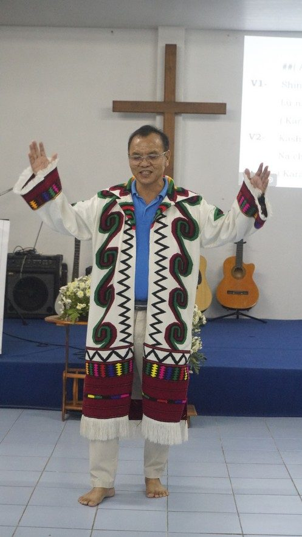
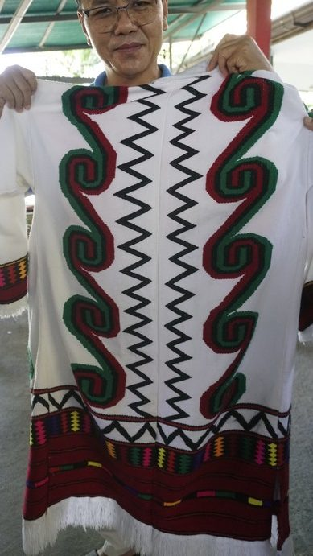
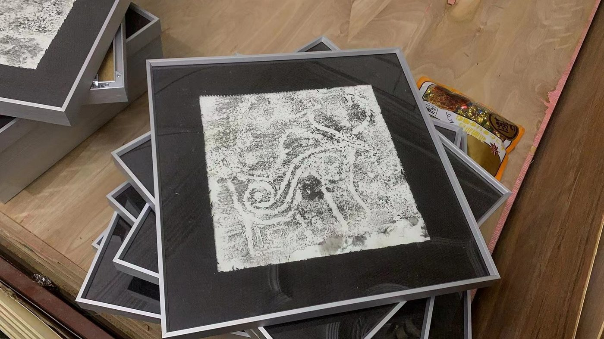
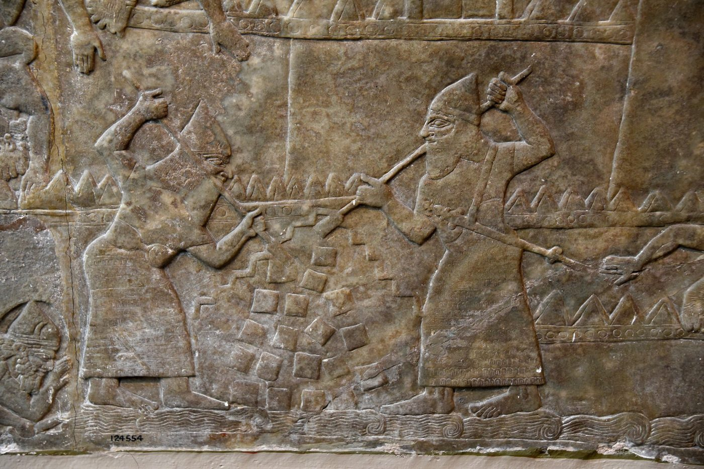
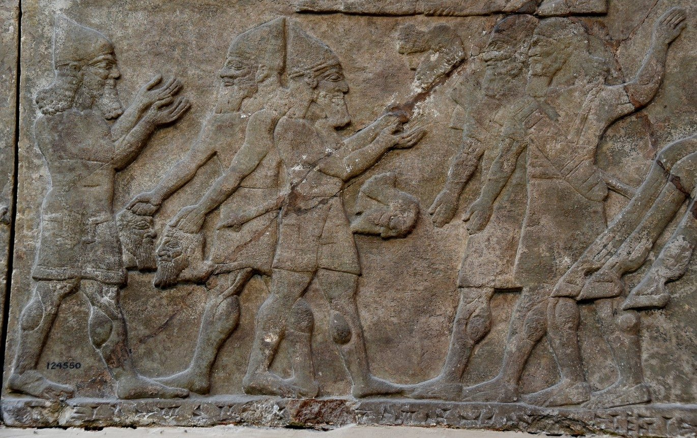

The Kachin, who call themselves Jinghpaw, live in the hills of northern Myanmar, in Yunnan in China, where they are called Jingpo, and in smaller communities in India and Thailand. Like the Karen, they remember a book that the Creator, Karai Kasang, gave their forefathers and that was later lost. This paper reads three patterns on the ceremonial robe of a Kachin priest in Chiang Mai, Thailand, and sets each one beside ancient Israel. It was written in Chinese. We give it here in Chinese and English.

克钦人自称“景颇”（Jinghpaw），居住在缅甸北部山区和中国云南（称景颇族），在印度和泰国也有较小的社群。与克伦人一样，他们记得造物主 Karai Kasang 曾赐给祖先一本书，后来那本书失落了。本文解读泰国清迈一位克钦族祭司法袍上的三个图案，并将每一个与古代以色列对照。本文原以中文写成，现以中英文对照刊出。

## 解读泰国清迈克钦族祭司法袍图案
## Reading the patterns of the Kachin priest's robe in Chiang Mai, Thailand

在清迈克钦族祭司法袍图案中，目前解读出三个与以色列有关联的图形：

In the patterns of the ceremonial robe of the Kachin priests in Chiang Mai, three figures connected with Israel have been read so far:

## 1、螺旋状 · 1. The spiral

这款图案在新龙拉麦岩画上可以找到相应的图形；在以色列国加利利北岸的迦百农（Kfar Nahum）犹太会堂的入大门的石头雕刻图案上也可以看到有这样的图形。她是“哈拉卡”图案标识：

A matching figure is found in the Lamai rock carvings at Xinlong. The same figure can also be seen in the stone carvings at the entrance of the synagogue at Capernaum (Kfar Nahum), on the north shore of the Sea of Galilee in Israel. It is the sign of the halakha:

**单个这样的图案**：是表示“哈拉卡”不仅要有文字即成文法（Torah）的记录，还必须有口授口头法（halacha）让儿童承受而传承。犹太教大祭司有专门指定教师来教授六岁到七岁的犹太儿童学习口头法（halacha）“哈拉卡”。口头法（halacha）一方面是从传统中根深蒂固的习俗演变而来，另一方面是从成文法（Torah）的解释中衍生出来的，她形成了犹太人的逻辑原则和犹太社会的司法程序体制，从而主导和发展犹太人的信仰和社会。

**A single spiral** means that the halakha needs more than a written record, the written law (Torah). It also needs an oral law (halakha) handed down to the children so that they carry it on. In Judaism the high priest appointed teachers especially to teach Jewish children of six and seven the oral law, the halakha. The oral law grew on the one hand out of customs deeply rooted in tradition, and on the other out of the interpretation of the written law (Torah). It shaped the Jewish way of reasoning and the system of courts in Jewish society, and so it led and shaped Jewish faith and society.

**哈拉卡**（希伯来语，halakhah，Halacha，Halocho，中文又译作**哈拉哈**），是犹太教口传律法的统称。其内容包括所有《米示拿》与《革马拉》里的律法、规章，以及与它们相关的一切判例与参考意见。《妥拉》的诫命形成了《哈拉卡》的基础，是犹太人必须遵循的道德与礼仪律令，也象征着“应当遵循”的行为标准。

**Halakha** (Hebrew *halakhah*, also spelled Halacha or Halocho, and in Chinese also 哈拉哈) is the name for the whole oral law of Judaism. It takes in all the laws and rulings of the Mishnah and the Gemara, with every case and opinion connected to them. The commandments of the Torah are the foundation of the halakha. They are the moral and ritual laws that Jews must keep, and they stand for the standard of conduct that "ought to be followed."

从古至今，《妥拉》律法透过《米示拿》、《他勒母》、《米示拿妥拉》、《四册法典》、《备好的桌子》与《答问集》等经典文献不断地被修正、延伸、扩充，甚至被限缩。这一系列的律法文献借由案例法的诠释与演进来发展《哈拉卡》。

From ancient times to today, the law of the Torah has been revised, extended, expanded and even narrowed through classic texts such as the Mishnah, the Talmud, the Mishneh Torah, the Four Rows (*Arba'ah Turim*), the Set Table (*Shulchan Aruch*) and the collections of questions and answers (responsa). Through this chain of legal writings the halakha grew by the interpretation and development of case law.

《**妥拉**》（希伯来语，英语：Torah，字面意思为指引、教导），又译为**托辣**、**托拉**，为犹太教的核心。它的意义广泛，可以指塔纳赫（Tanakh）24部经中的前五部，也就是一般常称的《摩西五经》（Pentateuch）。她也可以被用来指由创世纪开始，一直到塔纳赫结尾的所有内容。她也可以将拉比注释书包括在内。妥拉的字面意思为指引，她指导犹太教徒的生活方式，因此，所有的犹太教律法与教导，通通都可以被涵盖到妥拉中。

The **Torah** (Hebrew; the word means guidance or teaching), also written 托辣 or 托拉 in Chinese, is the heart of Judaism. Its meaning is broad. It can mean the first five of the 24 books of the Tanakh, commonly called the Five Books of Moses (the Pentateuch). It can mean everything from Genesis to the end of the Tanakh. It can also take in the rabbis' commentaries. Torah means guidance, and it guides the Jewish way of life, so all Jewish law and teaching can be counted as Torah.

**呈连续的螺旋状图案**：则象征着开始和结束，是表示这“哈拉卡”是源自“首先的和末后的”。亚力弗-塔夫，阿尔法-俄梅戛，神从起初就知道末后的事，亚伯拉罕的后裔们可以安全地信靠祂，祂的存在和计划包罗万有，支撑一切。

神是需要被完全信靠和仰赖的！

**A continuous spiral** stands for the beginning and the end. It shows that the halakha comes from the one who is "the first and the last": Aleph and Tav, Alpha and Omega. God knew the end from the beginning, and the descendants of Abraham can safely trust him. His being and his plan take in everything and hold everything up.

God is to be trusted and relied on completely!

## 2、三角形 · 2. The triangle

这个连串的三角形图案其实是古代以色列城墙上的图案形状，这个线索可以从亚述雕刻上看到。雕刻图案的内容是二个亚述兵丁正在拆毁北国以色列国的城邑，城墙上有三角形的建筑物。

This row of triangles is in fact the shape found on the walls of ancient Israel. The clue can be seen in Assyrian carvings. They show two Assyrian soldiers tearing down a city of the northern kingdom of Israel, with triangular forms along the top of its walls.

家破国亡刻骨铭心，世代不忘！

A home destroyed and a nation lost cut to the bone. They are never forgotten, generation after generation!

## 3、繸子 · 3. The tassels

这个繸子的以色列元素特征，可以从圣经文字上看到：

“你吩咐以色列人，叫他们世世代代在衣服边上做繸子，又在底边的繸子上钉一根蓝细带子。你们佩带这繸子，好叫你们看见就记念遵行耶和华一切的命令，不随从自己的心意、眼目行邪淫，像你们素常一样。”（民数记 15:38–39 和合本）

“你要在所披的外衣上四围做繸子。”（申命记 22:12 和合本）

这服装上繸子的本意，在犹太经典的摩西五经中，一览无遗，毋须赘言。

The Israelite character of these tassels can be seen in the words of Scripture:

"Speak to the children of Israel, and tell them that they should make themselves fringes on the borders of their garments throughout their generations, and that they put on the fringe of each border a cord of blue. It shall be to you for a fringe, that you may see it, and remember all Yahweh's commandments, and do them; and that you don't follow your own heart and your own eyes, after which you used to play the prostitute." (Numbers 15:38–39, World English Bible)

"You shall make yourselves fringes on the four corners of your cloak with which you cover yourself." (Deuteronomy 22:12, World English Bible)

The meaning of tassels on a garment is plain in the Five Books of Moses, the classic text of the Jews, and needs no more comment.

## Notes from the Institute

- **Teachers for young children.** The Babylonian Talmud (Bava Batra 21a) credits the high priest Joshua ben Gamla with placing teachers in every town and enrolling children at six or seven.
- **The law books.** The texts named above are the Mishnah (about AD 200), the Talmud, Maimonides' *Mishneh Torah* (12th century), Jacob ben Asher's *Arba'ah Turim* (14th century), Joseph Karo's *Shulchan Aruch* (1565) and the responsa.
- **"The first and the last."** God calls himself "the first and the last" in Isaiah 44:6 and 48:12, and declares "the end from the beginning" in Isaiah 46:10. "The Alpha and the Omega" is Revelation 22:13. Aleph and Tav are the first and last letters of the Hebrew alphabet.
- **The Assyrian carvings.** The reliefs shown come from the palace of Tiglath-Pileser III at Nimrud. He took the towns of Galilee and Naphtali and carried their people to Assyria in 733–732 BC (2 Kings 15:29), and one of his reliefs, now known only from a drawing made in the 1840s, names a besieged city Gaz[ru], almost certainly Gezer in Israel. We could not confirm from the photographs alone which city these two panels show.
- **The spiral carvings.** We could not find a published record of the Lamai rock carvings at Xinlong; the rubbing shown here is the paper's own evidence. The synagogue standing at Capernaum today was built in the late Roman period, about the 4th to 5th century AD, over an older one.
- **The tassels.** Numbers 15:38–39 and Deuteronomy 22:12 read as quoted. Jews still wear these tassels, called *tzitzit*, on the corners of the prayer shawl.

## 学会注释

- **幼童的教师**。《巴比伦塔木德·末门篇》（Bava Batra 21a）记载，大祭司约书亚·本·迦玛拉（Joshua ben Gamla）在各城设立教师，儿童六七岁入学。
- **律法典籍**。上文所列依次为《米示拿》（约公元200年）、《塔木德》、迈蒙尼德的《米示拿妥拉》（12世纪）、雅各·本·亚设的《四册法典》（14世纪）、约瑟·卡罗的《备好的桌子》（1565年）以及答问集。
- **“首先的和末后的”**。见以赛亚书 44:6、48:12；“从起初指明末后的事”见以赛亚书 46:10；“阿拉法，俄梅戛”见启示录 22:13。亚力弗（א）与塔夫（ת）是希伯来字母的首尾两个字母。
- **亚述浮雕**。图中浮雕出自尼姆鲁德的提革拉毗列色三世王宫。他于公元前733至732年攻取加利利和拿弗他利，将居民掳到亚述（列王纪下 15:29）。他的一块浮雕今只存19世纪40年代的摹图，上面所刻被围之城名为Gaz[ru]，几乎可以肯定是以色列的基色。仅凭照片，我们无法确定这两块浮雕所描绘的是哪一座城。
- **螺旋刻纹**。我们未能找到有关新龙拉麦岩画的已出版记录，此处拓片是本文作者提供的证据。今日迦百农的犹太会堂建于罗马帝国晚期（约公元4至5世纪），建在一座更早的会堂之上。
- **繸子**。民数记 15:38–39 与申命记 22:12 经文如上所引。犹太人至今仍在祈祷披巾的四角佩戴这种繸子，希伯来语称为 *tzitzit*。

*Photographs from the original paper.* *照片取自原文。*
